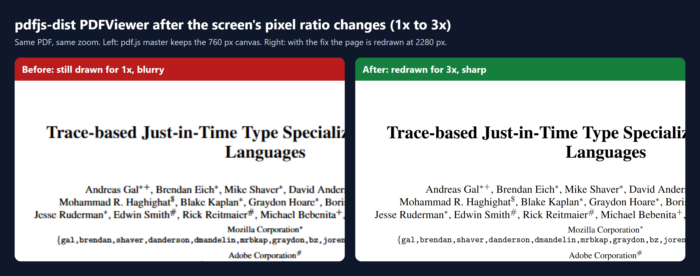

# Sharp pdfjs-dist pages after a pixel ratio change

When the screen's pixel ratio changes, the `PDFViewer` component from `pdfjs-dist` keeps drawing pages for the old ratio, so they go blurry. This repo shows the problem, the fix, and a way to reproduce both.

**Upstream PR:** [mozilla/pdf.js#22320](https://github.com/mozilla/pdf.js/pull/22320)



## The problem

Many apps embed the viewer component (`pdfjs-dist/web/pdf_viewer.mjs`) instead of the full pdf.js viewer: document portals, e-signature and contract tools, dashboards. The device pixel ratio (DPR) changes when you:

- move the window between a normal and a Retina or 4K monitor,
- zoom the page in the browser (Ctrl + / Ctrl -).

The full pdf.js viewer handles this by listening for a `(resolution: Xdppx)` media query change and calling `pdfViewer.refresh()`. That listener lives in `web/app.js`, though, which isn't part of the component build. So in apps that embed `PDFViewer`:

| After the DPR change | Effect |
| --- | --- |
| 1x → 2x/3x | Pages stay at the old resolution and the text looks soft |
| 2x/3x → 1x | Canvases stay oversized and use more memory than needed |

The pages only get sharp again when something else makes pdf.js redraw them, like a zoom change from the app's own controls.

## The fix

The listener moves from `app.js` into `PDFViewer.setDocument`:

```js
// Re-render the pages when the device pixel ratio changes, e.g. when the
// window is moved to a monitor with a different resolution, such that they
// don't become blurry.
const onResolutionChange = (evt = null) => {
  if (evt) {
    this.refresh();
  }
  window
    .matchMedia(`(resolution: ${OutputScale.pixelRatio}dppx)`)
    .addEventListener("change", onResolutionChange, {
      once: true,
      signal,
    });
};
onResolutionChange();
```

- **Same pattern as before.** A media query only matches one exact ratio, so after each change the listener registers itself again for the new ratio (`once: true`).
- **Cleaned up with the document.** `signal` comes from the viewer's per-document `#eventAC`, which `_resetView()` aborts when the document changes or closes.
- **No change for Firefox or the default viewer.** `PDFViewerApplication` uses `PDFViewer` too, so the duplicate listener in `app.js` is removed.

The full change is in [`viewer-resolution-change.patch`](viewer-resolution-change.patch) (+17 / −15 lines in `web/pdf_viewer.js` and `web/app.js`).

## Results

`tracemonkey.pdf` at `page-width` in an 800 px wide window, with the DPR switched from 1 to 3:

| | Page 1 canvas width (CSS width 760 px) |
| --- | --- |
| pdf.js `master` | 760 px, not redrawn (blurry) |
| With the fix | 2280 px, redrawn for 3x (sharp) |

The pdf.js unit tests pass with the fix: 1760 specs, 0 failures.

## Reproduce it

You need Node.js and Google Chrome.

```bash
git clone https://github.com/mozilla/pdf.js.git
cd pdf.js
npm ci
npx gulp generic components
```

Then run the demo against that checkout (set `CHROMIUM_PATH` to your Chrome binary):

```bash
node ../pdfjs-viewer-dpr-fix/demo/run.mjs . before.png
```

To try the fix, apply the patch, rebuild the components and run it again:

```bash
git am ../pdfjs-viewer-dpr-fix/viewer-resolution-change.patch
npx gulp components
node ../pdfjs-viewer-dpr-fix/demo/run.mjs . after.png
```

The script prints the canvas size before and after the change, and `rerenderedSharp: true` when the page was redrawn.

**A note on testing:** Chrome's DPR emulation updates `devicePixelRatio` but doesn't fire the media query `change` event that a real monitor or zoom change fires. So `run.mjs` records the listener the viewer registers and fires it itself after switching to 3x. That's why `master` shows 0 listeners fired: nothing in the component is listening.

### Files

- `demo/index.html`: a minimal page that embeds `PDFViewer` from the components build
- `demo/run.mjs`: switches the DPR from 1 to 3, checks the canvas and saves a screenshot
- `demo/compose.mjs`: builds `docs/before-after.png` from the two screenshots

## Author

Orieb Ghassab, [@oriebalzyuot96](https://github.com/oriebalzyuot96)
